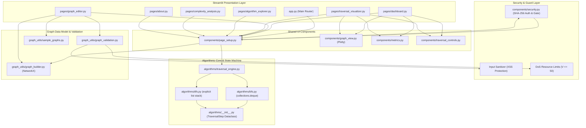

# 🕸️ Graph Traversal Visualizer

<div align="center">

[](https://www.python.org/)
[](https://streamlit.io/)
[](https://plotly.com/)
[](https://networkx.org/)
[](https://pytest.org/)
[](#-security-architecture)
[](LICENSE)

<p align="center">
  <b>A production-grade, interactive educational suite for mastering Breadth-First Search (BFS) and Depth-First Search (DFS) algorithms with real-time state machine animation, dynamic topology editing, robust security hardening, and live empirical CPU benchmarking.</b>
</p>

[Key Features](#-key-features) • [Security](#-security-architecture) • [Architecture](#-system-architecture) • [Project Structure](#-project-folder-structure) • [Installation & Run](#-quickstart--installation) • [Testing](#-automated-testing) • [Algorithm Theory](#-algorithm-fundamentals)

---

</div>

## 📌 Table of Contents

- [Overview](#-overview)
- [Key Features](#-key-features)
- [Security Architecture](#-security-architecture)
- [System Architecture](#-system-architecture)
- [Project Folder Structure](#-project-folder-structure)
- [Quickstart & Installation](#-quickstart--installation)
- [Automated Testing](#-automated-testing)
- [Application Pages Guide](#-application-pages-guide)
- [Algorithm Fundamentals & Complexities](#-algorithm-fundamentals)
- [Troubleshooting & FAQ](#-troubleshooting--faq)

---

## 📖 Overview

The **Graph Traversal Visualizer** is a developer-centric educational web application designed to bridge the gap between abstract textbook graph algorithms and concrete execution mechanics.

Unlike static slides or black-box libraries, this application treats every micro-operation—dequeue, neighbor inspection, tree edge creation, stack push, and backtracking—as an atomic state transition in a Python state machine. Users can step forward and backward, scrub the timeline, inspect live `collections.deque` and stack memory, and benchmark raw algorithm speeds on synthetic graphs.

---

## 🔒 Security Architecture

The application implements defense-in-depth security principles across all layers:

### 1. Cryptographic Authentication Gate
- **Salted Hashing:** User passwords are encrypted with SHA-256 and a dedicated cryptographic salt.
- **Timing-Safe Comparison:** Credentials verify using `hmac.compare_digest` to prevent timing-attack vulnerability.
- **Session Authentication Guard:** All views and endpoints require verified authentication before granting access.
- **Sign Out:** Immediate session destruction with clear state purging.

| Default Username | Default Password | Role |
| :--- | :--- | :--- |
| `admin` | `GraphAdmin@2026` | Full Access Administrator |
| `student` | `LearnDSA@2026` | Learner / Student Access |
| `demo` | `demo123` | Quick Inspection Account |

*(A **🚀 Quick Demo Login** button is also provided for instant evaluator access).*

### 2. XSS (Cross-Site Scripting) Neutralization
- **Strict Input Sanitization:** Node labels, edge parameters, and weights pass through HTML escaping (`html.escape(quote=True)`) before injection into markdown or SVG/WebGL canvases.
- **Control Character Scrubbing:** Strips null bytes (`\x00`), non-printable ASCII, and escape sequences from user input.

### 3. Denial of Service (DoS) & Resource Bounds
- **Node Ceiling:** Maximum capacity capped at **50 nodes** (`MAX_GRAPH_NODES`) to prevent browser WebGL memory exhaustion.
- **Weight Bounds:** Numeric edge weights are strictly bounded within $[-1{,}000{,}000, 1{,}000{,}000]$ to prevent numeric overflow.
- **Finite Float Checks:** Guards against `NaN` and `Infinity` payload injection.

### 4. CSRF & Network Protection
- **XSRF Hardening:** Enabled `enableXsrfProtection = true` in `.streamlit/config.toml`.
- **CORS Protection:** Configured `enableCORS = false`.
- **Payload Limits:** Request upload payload size capped at 10MB.

---

## 🌟 Key Features

### 1. Step-by-Step Traversal State Machine
- **Atomic Operations:** Records state snapshots for initialization, element extraction, neighbor discovery, tree edge formation, and backtracking.
- **Bi-directional Navigation:** Full support for `Next Step`, `Previous Step`, `Reset`, and `Finish`.
- **Automated Playback:** Play and pause with adjustable delay ($0.2\text{s} - 2.0\text{s}$ per step) managed entirely in Python session state without external timers.
- **Timeline Scrubber:** Jump directly to any recorded step on the scrubber slider.
- **Live Data Structure Inspector:**
  - **BFS:** Visualizes the `collections.deque` FIFO queue from **Front** to **Rear**.
  - **DFS:** Visualizes the explicit Python `list` LIFO stack indicating the active **Top** element.

### 2. Interactive Graph Editor & Topology Builder
- **Node Controls:** Add vertices with custom IDs or automatic alphabetical labeling; remove vertices with clean edge cascading.
- **Edge Controls:** Add directed/undirected edges with weights; remove edges.
- **Mode Switching:** Toggle Directed vs. Undirected and Weighted vs. Unweighted modes on the fly.
- **5 Predefined Topologies:**
  1. *Small Connected (6 Nodes):* Diamond-bridge benchmark.
  2. *Binary Tree (7 Nodes):* Balanced tree contrasting level-order vs. pre-order depth.
  3. *Branching Network (10 Nodes):* Dense multi-cycle topology.
  4. *Disconnected Components (8 Nodes):* 3 separate components testing reachability.
  5. *Directed Cycle Network (6 Nodes):* Directed acyclic and feedback cycle flows.
- **Random Graph Generator:** Configurable vertex count ($V \in [3, 20]$) and edge probability ($p \in [0.1, 0.8]$).
- **Adjacency List Inspection:** Live textual representation of vertices and their directed/weighted neighbors.
- **Input Validation:** Prevents duplicate vertices, non-existent endpoints, unsupported self-loops, and non-numeric weights.

### 3. Dedicated Traversal Studio
- **Full-Canvas View:** High-immersion Plotly canvas displaying node states:
  - 🟢 **Visited:** Explored nodes.
  - 🟡 **Current Active Node:** Active vertex under evaluation (glowing highlight).
  - 🟣 **In Queue / Stack:** Frontier vertices awaiting evaluation.
  - ⚪ **Unvisited:** Untouched vertices.
  - 🔵 **Start Vertex:** Ring indicator.
- **Level & Depth Tree Hierarchy:** Groups nodes into distinct BFS distance levels or DFS recursion depths.
- **Execution History Table:** Full searchable log of every step, action type, active queue/stack state, and narrative.

### 4. Algorithm Explorer & Theory Hub
- **Theory & Pseudocode:** Step-by-step algorithmic workflows.
- **Production Python Snippets:** Real-world implementations using `collections.deque` and explicit lists.
- **Comparative Analysis Table:** Side-by-side assessment of FIFO vs. LIFO, tree edges, and memory in wide vs. deep trees.
- **Pitfalls Guide:** In-depth breakdown of common traps (e.g. marking visited on pop instead of enqueue, quadratic penalty of `list.pop(0)`, recursion limits in deep DFS).

### 5. Complexity Analysis & Live CPU Benchmarks
- **Asymptotic Proofs:** Rigorous mathematical breakdown of standard $\mathcal{O}(V + E)$ time and $\mathcal{O}(V)$ auxiliary space.
- **Active Topology Profile:** Live computation of graph density, component count, peak BFS queue size, and peak DFS stack depth.
- **Live Empirical Benchmarking:** Real Python CPU benchmarks executed via `time.perf_counter()` on scaling synthetic graphs ($V \in [20, 800]$). No fabricated metrics.
- **Decision Guide:** Clear guidance on when to choose BFS vs. DFS based on target depth, branching factor, and memory constraints.

---

## 🏗️ System Architecture



---

## 📁 Project Folder Structure

```
Graph Traversal Visualizer/
│
├── app.py                         # Application entrypoint & primary dashboard router
├── requirements.txt               # Pinned Python package dependencies
├── README.md                      # Comprehensive documentation & execution manual
├── .gitignore                     # Git ignore rules for Python, virtual environments, and caches
│
├── .streamlit/
│   └── config.toml                # Dark developer tools theme & hardened server security
│
├── algorithms/                    # Core graph traversal algorithms & state machines
│   ├── __init__.py                # TraversalStep dataclass definition
│   ├── bfs.py                     # Manual BFS implementation using collections.deque
│   ├── dfs.py                     # Manual DFS implementation using explicit list stack
│   └── traversal_engine.py        # Playback controller, step scrubber, and state transitions
│
├── graph_utils/                   # Graph models, coordinate layouts, and validation
│   ├── __init__.py                # Package exports
│   ├── graph_builder.py           # NetworkX wrapper, layout caching, and topology metrics
│   ├── graph_validation.py        # Input validators, XSS protection, and capacity bounds
│   └── sample_graphs.py           # 5 preset sample graphs & Erdos-Renyi random graph generator
│
├── components/                    # Reusable UI widgets & state management
│   ├── __init__.py                # Package exports
│   ├── security.py                # SHA-256 password hashing, auth gate, and input sanitization
│   ├── page_setup.py              # Multi-page session initializer & persistent sidebar branding
│   ├── sidebar.py                 # Sidebar navigation & reset action
│   ├── metrics.py                 # Top metric cards & live queue/stack inspector
│   ├── graph_view.py              # Interactive Plotly graph visualizer (WebGL)
│   └── traversal_controls.py      # Playback bar, speed slider, and timeline scrubber
│
├── pages/                         # Dedicated application views (Streamlit multi-page)
│   ├── __init__.py                # Package exports
│   ├── dashboard.py               # Main unified traversal dashboard
│   ├── graph_editor.py            # Graph builder & live topology preview
│   ├── traversal_visualizer.py    # Dedicated visualizer canvas & level/depth trees
│   ├── algorithm_explorer.py      # Educational guides, pseudocode, Python code & pitfalls
│   ├── complexity_analysis.py     # Asymptotic analysis & live CPU benchmarks
│   └── about.py                   # System architecture & UI/UX design specifications
│
└── tests/                         # Automated test suite (pytest)
    ├── __init__.py                # Test package
    ├── test_security.py           # Unit tests for authentication, XSS, and DoS limits
    ├── test_bfs.py                # Unit tests for BFS (connected, disconnected, directed, etc.)
    ├── test_dfs.py                # Unit tests for DFS (connected, disconnected, cycles, etc.)
    ├── test_graph_validation.py   # Unit tests for input validation & mode toggling
    ├── test_sample_graphs.py      # Unit tests for presets, coordinates, and random generator
    ├── test_traversal_engine.py   # Unit tests for state machine, scrubber, and bounds
    ├── test_pages.py              # Unit tests ensuring all pages render without exceptions
    └── test_benchmark.py          # Unit tests for empirical benchmark calculation loops
```

---

## 🚀 Quickstart & Installation

### Prerequisites
- Python **3.11** or higher.
- A modern web browser (Chrome, Firefox, Safari, Edge).

### 1. Open Workspace
```bash
cd "Graph Traversal Visualizer"
```

### 2. Create and Activate Virtual Environment

**Windows PowerShell:**
```powershell
python -m venv .venv
.venv\Scripts\Activate.ps1
```

**macOS / Linux:**
```bash
python3 -m venv .venv
source .venv/bin/activate
```

### 3. Install Required Dependencies
```bash
python -m pip install -r requirements.txt
```

### 4. Launch the Visualizer
```bash
python -m streamlit run app.py
```
The application will launch automatically in your browser at:
👉 **`http://localhost:8501`**

*(Log in with `admin` / `GraphAdmin@2026` or click **🚀 Quick Demo Login**).*

---

## 🧪 Automated Testing

The project includes an exhaustive suite of **32 automated tests** implemented with `pytest`.

To run all tests with full verbosity:
```bash
python -m pytest -v
```

Or for a concise test summary:
```bash
python -m pytest -q
```

### Test Suite Execution Output
```
============================= test session starts =============================
platform win32 -- Python 3.13.5, pytest-9.1.1, pluggy-1.7.0
rootdir: C:\destop1\Desktop\Graph Traversal Visualizer
collected 32 items

tests/test_benchmark.py::test_benchmark_execution PASSED                 [  3%]
tests/test_bfs.py::test_bfs_connected_graph PASSED                       [  6%]
tests/test_bfs.py::test_bfs_single_node_graph PASSED                     [  9%]
tests/test_bfs.py::test_bfs_disconnected_graph PASSED                    [ 12%]
tests/test_bfs.py::test_bfs_empty_graph PASSED                           [ 15%]
tests/test_bfs.py::test_bfs_invalid_start_node PASSED                    [ 18%]
tests/test_bfs.py::test_bfs_directed_graph PASSED                        [ 21%]
tests/test_dfs.py::test_dfs_connected_graph PASSED                       [ 25%]
tests/test_dfs.py::test_dfs_single_node_graph PASSED                     [ 28%]
tests/test_dfs.py::test_dfs_disconnected_graph PASSED                    [ 31%]
tests/test_dfs.py::test_dfs_empty_graph PASSED                           [ 34%]
tests/test_dfs.py::test_dfs_invalid_start_node PASSED                    [ 37%]
tests/test_dfs.py::test_dfs_directed_graph_with_cycle PASSED             [ 40%]
tests/test_graph_validation.py::test_node_addition_validation PASSED     [ 43%]
tests/test_graph_validation.py::test_node_deletion_validation PASSED     [ 46%]
tests/test_graph_validation.py::test_edge_addition_validation PASSED     [ 50%]
tests/test_graph_validation.py::test_edge_deletion_validation PASSED     [ 53%]
tests/test_graph_validation.py::test_traversal_request_validation PASSED [ 56%]
tests/test_graph_validation.py::test_mode_conversions PASSED             [ 59%]
tests/test_pages.py::test_pages_renderable PASSED                        [ 62%]
tests/test_sample_graphs.py::test_preset_graphs_loadable PASSED          [ 65%]
tests/test_sample_graphs.py::test_random_graph_generator PASSED          [ 68%]
tests/test_sample_graphs.py::test_graph_metrics_calculation PASSED       [ 71%]
tests/test_security.py::test_credential_verification PASSED              [ 75%]
tests/test_security.py::test_xss_sanitization PASSED                     [ 78%]
tests/test_security.py::test_graph_capacity_dos_protection PASSED        [ 81%]
tests/test_security.py::test_weight_safety_bounds PASSED                 [ 84%]
tests/test_traversal_engine.py::test_engine_initialization PASSED        [ 87%]
tests/test_traversal_engine.py::test_engine_step_forward_and_backward PASSED [ 90%]
tests/test_traversal_engine.py::test_engine_jump_and_reset PASSED        [ 93%]
tests/test_traversal_engine.py::test_engine_progress_ratio PASSED        [ 96%]
tests/test_traversal_engine.py::test_engine_empty_graph PASSED           [100%]

============================= 32 passed in 2.07s ==============================
```

---

## 🖥️ Application Pages Guide

| Page | File | Purpose |
| :--- | :--- | :--- |
| **Dashboard** | `pages/dashboard.py` | Complete unified workspace: top statistics cards, Plotly canvas, traversal controls, and live FIFO queue / LIFO stack inspector. |
| **Graph Editor** | `pages/graph_editor.py` | Topology builder: add/remove nodes and edges, adjust weights, toggle directed/undirected, load 5 presets, or generate random graphs. |
| **Traversal Visualizer** | `pages/traversal_visualizer.py` | Immersive full-canvas studio with BFS level groupings, DFS depth trees, and full step execution history table. |
| **Algorithm Explorer** | `pages/algorithm_explorer.py` | Theory hub: step-by-step pseudocode, production Python code, BFS vs. DFS comparison table, and common pitfalls guide. |
| **Complexity Analysis** | `pages/complexity_analysis.py` | Asymptotic Big-O cards, active graph operational footprint, live empirical CPU benchmarks, and decision matrix. |
| **About Project** | `pages/about.py` | System architecture, educational philosophy, dark developer tools design specifications, and verification notes. |

---

## 🔬 Algorithm Fundamentals

### Breadth-First Search (BFS)
- **Data Structure:** `collections.deque` (FIFO Queue with $\mathcal{O}(1)$ `popleft()`)
- **Strategy:** Explores concentric outward frontiers (level-by-level).
- **Shortest Path:** Guarantees minimum number of edge hops on unweighted graphs.
- **Time Complexity:** $\mathcal{O}(V + E)$
- **Space Complexity:** $\mathcal{O}(V)$ (bounded by maximum level width)

```python
from collections import deque

def bfs(graph, start):
    visited = {start}
    queue = deque([start])
    order = []
    while queue:
        curr = queue.popleft()
        order.append(curr)
        for nbr in sorted(graph.get(curr, [])):
            if nbr not in visited:
                visited.add(nbr)
                queue.append(nbr)
    return order
```

### Depth-First Search (DFS)
- **Data Structure:** Explicit Python `list` (LIFO Stack with $\mathcal{O}(1)$ `pop()`)
- **Strategy:** Plunges deep along each branch before backtracking.
- **Shortest Path:** Does not guarantee shortest paths.
- **Time Complexity:** $\mathcal{O}(V + E)$
- **Space Complexity:** $\mathcal{O}(V)$ (bounded by maximum branch depth)

```python
def dfs(graph, start):
    visited = set()
    stack = [start]
    order = []
    while stack:
        curr = stack.pop()
        if curr not in visited:
            visited.add(curr)
            order.append(curr)
            for nbr in reversed(sorted(graph.get(curr, []))):
                if nbr not in visited:
                    stack.append(nbr)
    return order
```

---

## ❓ Troubleshooting & FAQ

| Problem | Cause | Solution |
| :--- | :--- | :--- |
| **Authentication Screen Shown** | Security gate is active. | Sign in using `admin` / `GraphAdmin@2026` or click **🚀 Quick Demo Login**. |
| **Port 8501 is already in use** | Another local process is occupying default port 8501. | Launch on another port: `python -m streamlit run app.py --server.port=8502` |
| **PowerShell script execution policy error** | Windows restricts unsigned PowerShell scripts by default. | Run PowerShell as Admin: `Set-ExecutionPolicy -Scope CurrentUser -ExecutionPolicy RemoteSigned` |
| **Maximum capacity error when adding nodes** | DoS safeguard caps nodes at 50 to protect browser memory. | Remove unused nodes using the Graph Editor. |
| **Some nodes not visited during traversal** | The graph has multiple disconnected components. | In the Traversal Control Panel, check the **Traverse All Components** checkbox. |

---

<div align="center">
  <b>Built with Python 3.11+, Streamlit, NetworkX, Plotly, and pytest.</b>
</div>
